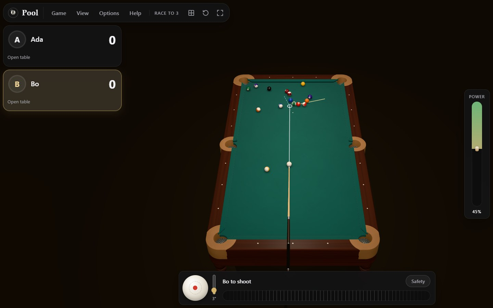
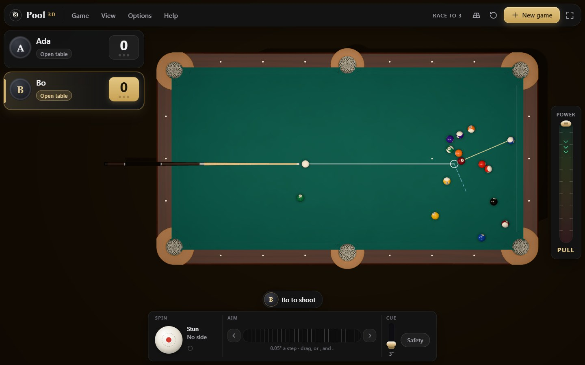
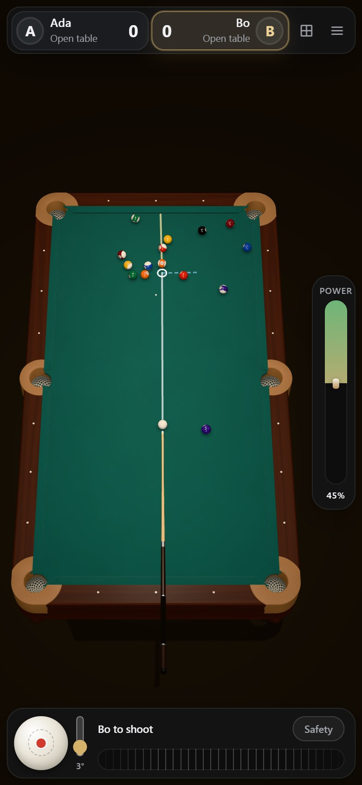

# Pool

A realistic 3D 8-ball game for the browser. Play on your own, against a friend on the same device,
or against a friend online with voice and video, on a 9-foot tournament table or a 7-foot bar
table, seen in 3D or straight from above.



## What is in it

- **Real billiards physics.** The simulation is a TypeScript translation of
  [pooltool](https://github.com/ekiefl/pooltool) 0.6.0: balls slide, roll and spin; collisions
  between balls have friction and throw; cushions are compliant and grip the ball; draw, follow,
  side spin and squirt all come out of the physics. On pooltool's own test shots it reproduces
  pooltool event for event (17 of 18 scenarios to within 4·10⁻¹⁴ s), and a ball runs as far as
  published figures say (the WPA's table-speed test, Dr. Dave's travel distances). See
  [docs/physics.md](docs/physics.md).
- **The same shot, to the last bit, in every browser.** The physics uses only exactly rounded
  arithmetic, so Chromium, Firefox and WebKit compute a shot identically. That is what lets two
  players online each simulate every shot themselves and agree.
- **The WPA's World Standardized Rules of 8-ball**: the break and its options, open table, groups,
  fouls with ball in hand, calling the 8's pocket, the shot clock, races to 1, 3, 5 or 7 racks. See
  [docs/rules.md](docs/rules.md).
- **Tables built from the specifications.** One description of each table (pocket mouths, cut
  angles, shelves, cushion height, sights) drives both the physics and the Blender model, so the
  cushions you see are the cushions the balls hit, to within 0.1 mm. See
  [docs/visual-research.md](docs/visual-research.md).
- **Two views of one table**: a 3D view that turns, tilts, zooms and pans, and an orthographic top
  view that turns, zooms and pans. Switching moves only the camera.
- **Online with a friend**: send a link or show a QR code, with voice and video in the players'
  cards: large, beside the table, on a tablet or a computer, and small, in the top bar, on a phone
  (Settings can change either; large cards on a phone held upright stand side by side under the
  buttons). There is no server: the two browsers meet through public Nostr relays, then talk
  directly over WebRTC, and each side referees every shot itself. See
  [docs/protocol.md](docs/protocol.md).
- **Recorded sounds** for every contact, chosen by what happened and how hard: the cue tip, ball on
  ball, cushions, jaws, pockets, the rack. See [docs/sounds.md](docs/sounds.md).

| Top view | On a phone |
|---|---|
|  |  |

## Playing

Choose **Practice** to play alone with no rules, **Two players** for a match on one device, **Play
a friend online** to invite someone, or **Join a game** to open a link you were sent. On a tablet
or a computer the menu bar along the top (Game, View, Options, Help) holds all of these, the view
and the settings; on a phone they are behind the menu button, or Settings can show the bar there
too. Escape opens the pause menu everywhere.

- **Aim** by dragging on the cloth (with a finger, sweep round the cue ball), or with Shift and the
  arrow keys; `,` and `.` aim finely.
- **Shoot** by pulling the power bar down and letting go, or set the power with Shift and ↑ ↓ and
  press Space. Each shot starts from no power; taking a pull back to the top of the bar and
  letting go there shoots nothing, so you can stop, aim again and pull again.
- **Spin**: drag the point on the cue ball in the dock, or use I J K L. The slider beside it raises
  the cue. A cue never passes through a rail or a ball: where it would, it rises just far enough
  to clear them, and the shot is struck at that elevation.
- **Ball in hand**: drag the cue ball.
- **The camera** works as on the board of the chess game this one shares its interface with: drag
  a rail's corner (or the floor) to turn and tilt, a rail's side to pan, right-drag anywhere to
  turn, the wheel to zoom. The arrow keys turn and tilt, Page Up and Down zoom, Home resets, F looks
  from the other end and T switches to the top view. Two fingers twist, pinch and pan. The view
  keeps its zoom while it turns; Settings can refit the table to the screen at each angle instead.

Every key and gesture is listed in the game under **Keyboard and mouse** (or press `?`).

## Running it

```
npm ci
npm run dev          # the development server
npm run build        # type-check and build the site into dist/
npm test             # unit and architecture tests
npm run lint
npm run format:check
```

End-to-end tests drive real browsers against the production build. Run them **one file at a time**,
for example `npx playwright test tests/e2e/hotseat.spec.ts`; `tests/e2e/online.spec.ts` needs the
internet. The cross-browser determinism check is
`npx playwright test -c playwright.determinism.config.ts`.

The table and cue models are built with Blender 5.2 by `npm run models`, from the geometry that
`node scripts/export-table.ts` writes. pooltool's reference results come from
`tools/pooltool-fixtures/` (Python, set up with uv; only needed to regenerate them).

## Deploying

`.github/workflows/deploy.yml` publishes the site to GitHub Pages on every push to `main`, after
the lint, the tests, an audit of the whole history and of the built site, and the build. The site
is static: no server is needed, online play included.

## Known limits

- Online play connects the two browsers directly. Without a relay (TURN) server, about one pair of
  networks in ten cannot connect.
- Balls never leave the table and never jump: the simulation is planar, as pooltool's is.
- Only the 8's pocket is called.
- Frame rates were measured on a desktop GPU, phone screens included; no real phone has been
  measured. A device that animates at under 40 frames a second lowers its graphics by itself. See
  [docs/performance.md](docs/performance.md).
- The sounds were chosen from measurements of the recordings, not by ear.

## Licence

GPL-3.0-or-later (see [LICENSE](LICENSE)). The physics is translated from pooltool (Apache-2.0),
and the recorded hits are under the Pixabay Content License. Every third-party part and its licence
is listed in [NOTICE.md](NOTICE.md).
